# Kliqture

Kliqture is a professional platform built to help businesses, brands, skilled professionals, and creatives showcase their work, discover opportunities, find talent, and collaborate remotely.

> The production source code for Kliqture is private. This repository is a public product and engineering case study.

---

## My Role

**Founder & Software Engineer**

I designed and developed Kliqture across mobile engineering, backend systems, product architecture, user experience, and production deployment.

My work includes building the Flutter application, backend services, real-time experiences, opportunity and hiring workflows, workrooms, notifications, media experiences, and infrastructure required to operate the product.

---

## What Kliqture Does

Kliqture brings professional discovery, hiring, and collaboration into one platform.

Users can:

- Build professional or brand profiles
- Showcase skills, projects, and creative work
- Discover professionals and brands
- Publish projects and opportunities
- Seek specific expertise
- Apply for opportunities
- Review and select applicants
- Hire professionals
- Collaborate remotely
- Communicate through real-time conversations
- Organize project work and assigned tasks
- Manage professional engagements from discovery through delivery

---

## Tech Stack

### Mobile

- Flutter
- Dart

### Backend

- NestJS
- TypeScript
- REST APIs
- WebSockets

### Data & Infrastructure

- PostgreSQL
- AWS
- Firebase

### Platform Engineering

- Push notifications
- Real-time messaging
- Media delivery
- Authentication and authorization
- iOS deployment
- Android deployment

---

## Selected Engineering Work

Some of the systems and product flows I have worked on include:

- Cross-platform mobile architecture with Flutter
- Professional and business profile experiences
- Media-rich discovery feeds
- Project and engagement publishing
- Opportunity application workflows
- Applicant review and selection
- Hiring workflows
- Real-time conversations
- Collaboration and hire rooms
- Project task management
- Notification and deep-linking systems
- Backend APIs and application state synchronization
- Production iOS and Android deployment
- Payment-related workflow engineering

---

# Product Walkthrough

## Discover

Professionals and brands can discover people, work, and opportunities across the platform.

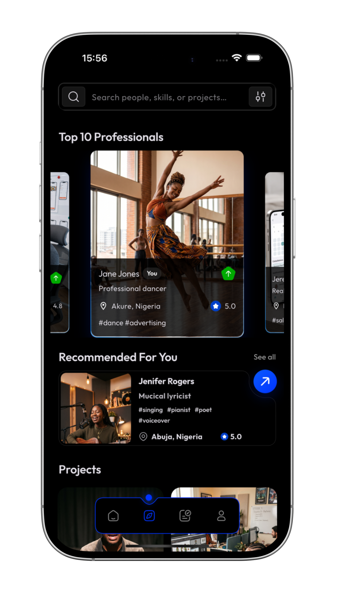

---

## Professional & Creative Feed

Kliqture supports different types of professionals and creative work rather than restricting users to a single professional identity.

### Singer & Songwriter

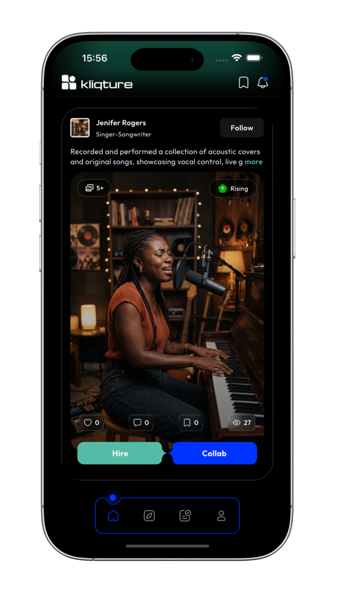

### Actor

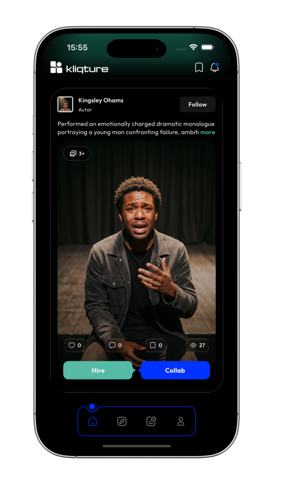

---

## Brand Opportunities

Brands and businesses can publish opportunities and seek professionals with specific expertise.

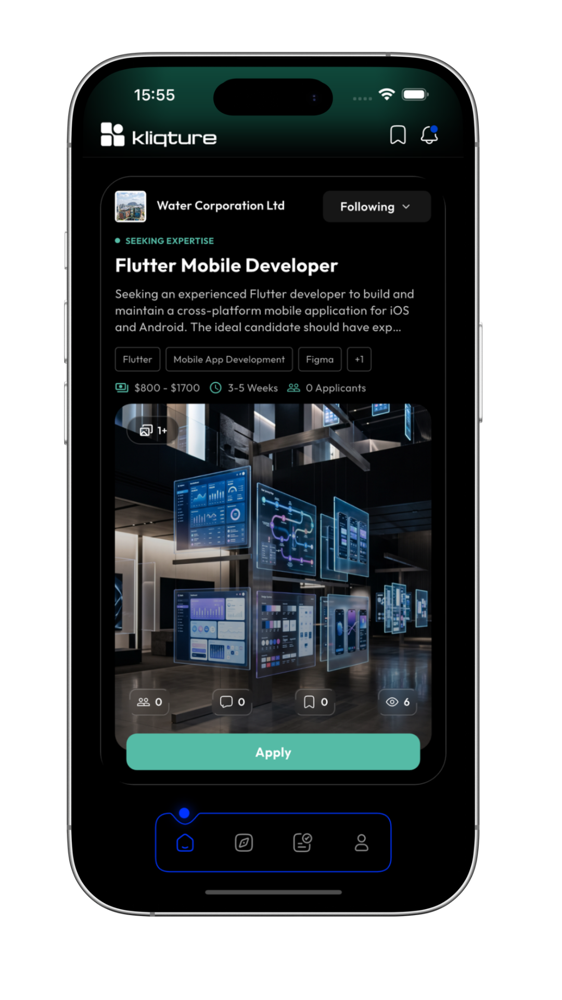

### Engagement Details

This example shows a brand seeking a Flutter developer.

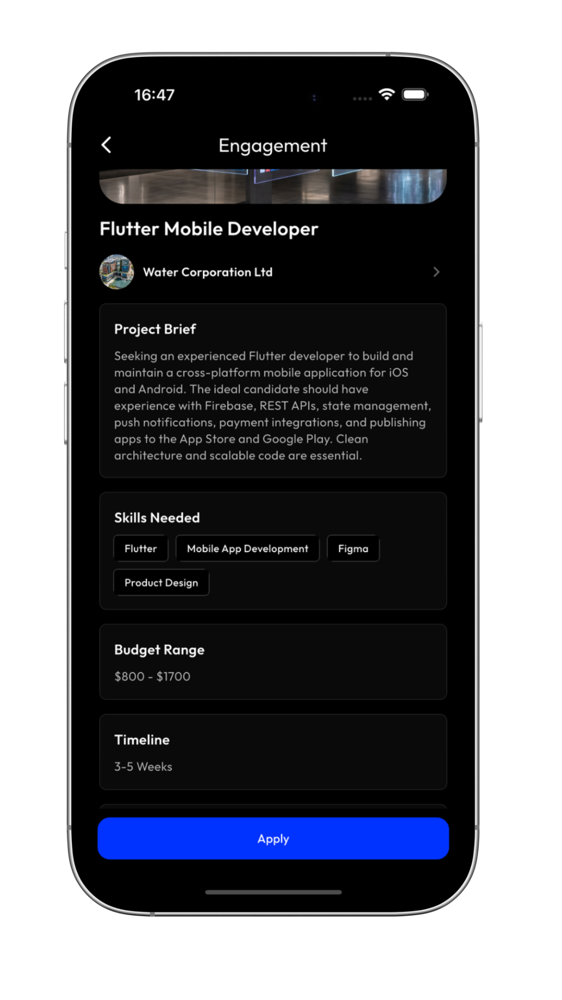

---

## Projects

Professionals can also showcase projects and work they have created.

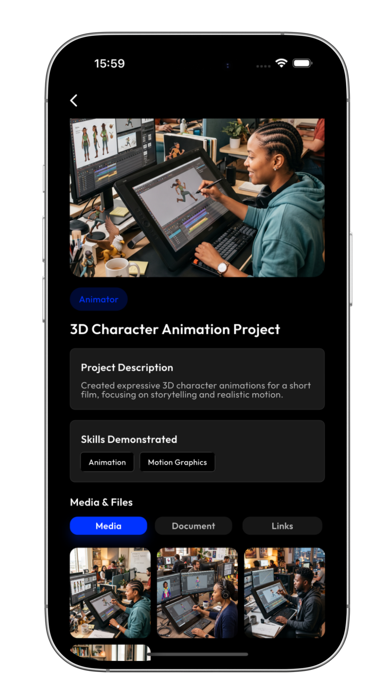

---

## Collaboration

Kliqture includes dedicated spaces for people working together after a professional connection has been made.

### Project Conversation & Deliverables

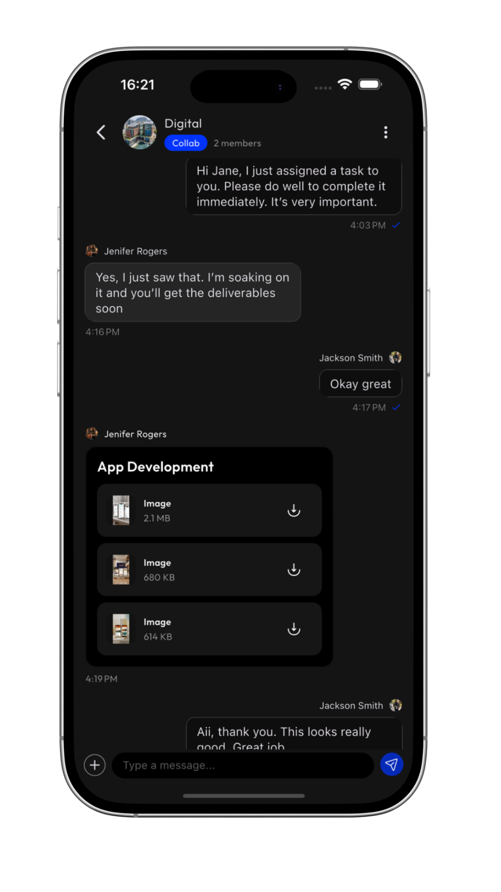

### Project Tasks

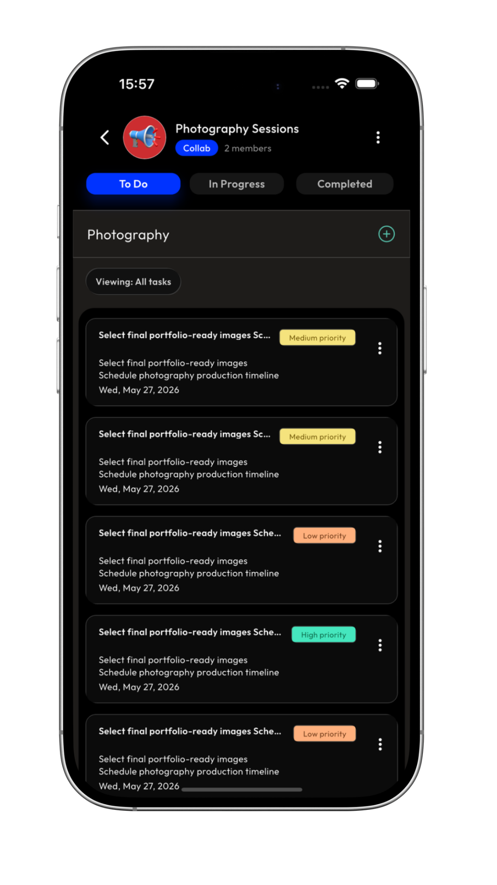

---

## Hire Workflow

The platform includes dedicated workflows for managing professional hiring engagements.

### Work Progress

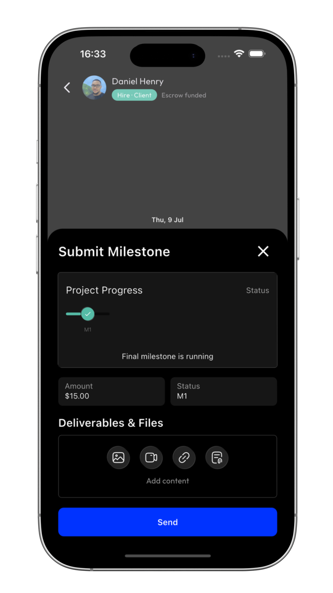

### Releasing Funds

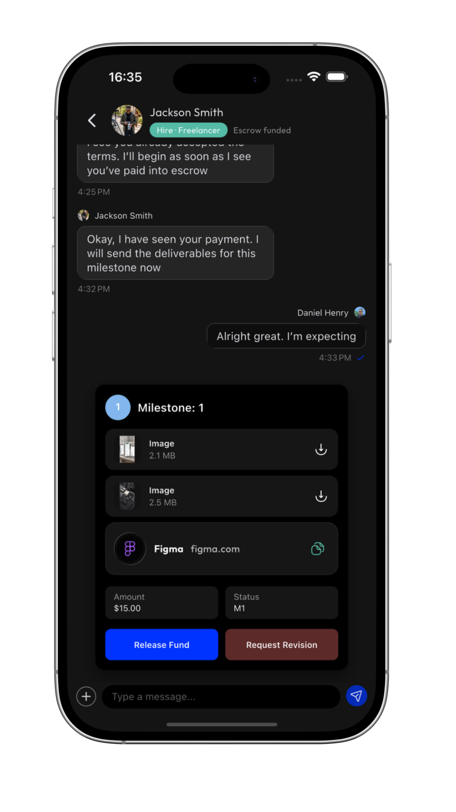

### Successful Release

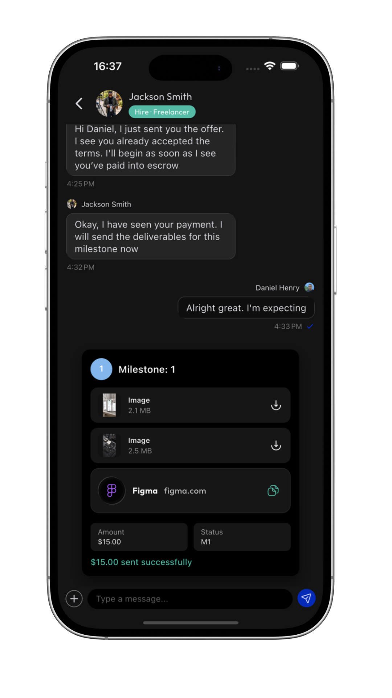

---

## Engineering Scope

Kliqture is not a UI prototype or tutorial application.

It is a full product involving multiple interconnected systems across mobile, backend, infrastructure, and product engineering.

A typical workflow can involve:

**Discovery → Opportunity → Application → Selection → Conversation → Workroom → Task Execution → Delivery**

Building these experiences has required handling areas such as:

- Complex application state
- Role-specific user experiences
- API design and integration
- Authentication
- Real-time communication
- File and media handling
- Push notifications
- Deep linking
- Error handling
- Data persistence
- Performance optimization
- Mobile release engineering
- Production environment management

---

## Architecture

At a high level, Kliqture uses a mobile-client and API architecture:

```text
Flutter Mobile Application
          │
          │
       REST APIs
          │
          ▼
    NestJS Backend
          │
     ┌────┴────┐
     │         │
 PostgreSQL   External Services
     │         │
     │      Firebase / AWS
     │
 Application Data
